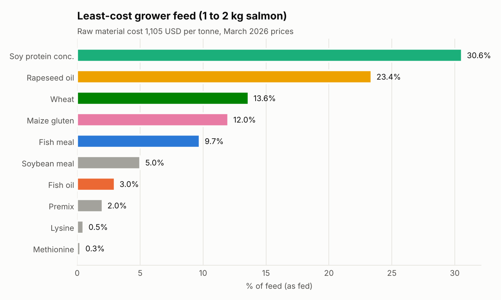
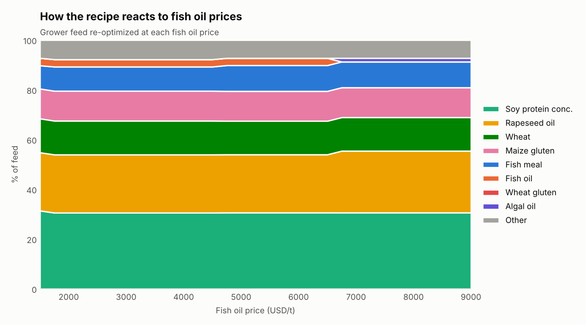

# Salmon Feed Optimizer

Least-cost formulation of Atlantic salmon feed with linear programming, built on free, sourced data, with the scenario and raw material planning questions a feed company deals with every day.



## What it does

Every batch of salmon feed is a recipe: some fish meal, some soy protein, some rapeseed oil, and so on. The job is to hit the fish's nutritional targets at the lowest cost, using raw materials you can actually get. This project does that and then asks the follow-up questions:

1. **Least-cost recipe.** Finds the cheapest mix of 15 ingredients that meets protein, fat, digestible energy, DP/DE ratio, EPA+DHA, phosphorus, fibre, ash, starch and 10 essential amino acid requirements for two fish sizes.
2. **Why the recipe looks like it does.** Shadow prices show which requirement is costing money, and reduced costs show how far an unused ingredient's price has to fall before it enters.
3. **Price shocks.** Re-optimizes as fish oil moves from 1,500 to 9,000 USD/t and shows where algal oil takes over.
4. **Nutrition targets.** Prices the cost of raising EPA+DHA in the feed.
5. **Supply disruption.** A late fish oil delivery caps what you can use; the model re-formulates around it.
6. **Sustainability.** Caps fish meal plus fish oil and shows the cost of lower forage fish dependency.
7. **Real price history.** Re-optimizes with World Bank prices from 2023 to April 2026.
8. **Benchmarking.** Compares the result with Norway's actual 2020 salmon feed (Nofima) and a measured Skretting commercial feed profile.
9. **Raw material planning.** Turns a recipe and a monthly production plan into tonnage, checks it against stock and inbound deliveries, flags shortfalls and re-formulates within what's available.

There is also a small Streamlit app to play with prices, targets and stock.

## Key results

March 2026 prices, grower feed for 1 to 2 kg fish:

| | Result |
|---|---|
| Raw material cost | **1,105 USD/t** |
| Recipe | Soy protein concentrate 30.6%, rapeseed oil 23.4%, wheat 13.6%, maize gluten 12.0%, fish meal 9.7%, soybean meal 5.0%, fish oil 3.0%, premix and amino acids 2.8% |
| Most expensive constraints | Fibre max (100 USD/t per point), EPA+DHA min (82 USD/t per point), methionine min (21) |
| Smolt feed (100 to 250 g) | 1,167 USD/t, with fish meal rising to 16% |
| EPA+DHA from 1% to 2% | +82 USD/t |
| Fish oil capped at 1% and 30% dearer | +71 USD/t, algal oil fills the gap |
| Fish meal + fish oil capped at 8% | only +10 USD/t |
| Fish oil price at which algal oil wins | about 6,750 USD/t |



**The interesting finding.** Fish oil inclusion barely moves as its price rises. That's because it's the cheapest way to meet the EPA+DHA minimum, so the recipe keeps buying just enough of it until algal oil becomes cheaper per gram of omega-3. Cost climbs linearly until that switch, then flattens. The shadow price on EPA+DHA tells the same story from the other side.

**Price history.** With 2023 prices the optimal recipe used 33% fish meal and no soy protein concentrate, because soybean meal (and so SPC) was expensive. By 2025 soy had fallen 32% and the recipe swung to 31% SPC and 10% fish meal. Same model, same nutrition, completely different shopping list. That's why recipes are re-optimized constantly.


**Benchmark against reality.** The model uses 12.7% marine ingredients versus 22% in Norway's 2020 average. That gap is honest and useful: the model only has to meet FAO's minimum EPA+DHA of 1%, while commercial feeds target more omega-3 for fish health and fillet quality, and they keep fish meal for palatability and functional reasons the LP doesn't price. Plant protein (48% vs 41%), vegetable oil (23% vs 20%) and carbohydrate (14% vs 13%) land close to the real numbers.


Full tables for every scenario are in [`outputs/summary.md`](outputs/summary.md).

## The model

Decision variable: `x_i`, the as-fed share of ingredient `i` in 1 kg of feed.

```
minimise    sum_i  price_i * x_i
subject to  sum_i  x_i = 1
            sum_i  x_i * nutrient_i  >=  requirement * sum_i x_i * dm_i      (dry matter basis, linear)
            sum_i  x_i * DP_i * 10   >=  k * sum_i x_i * DE_i               (DP/DE ratio)
            min_i  <=  x_i  <=  max_i                                       (practical inclusion limits)
            x_i    <=  available_i / production                             (stock, when planning)
```

FAO requirements are on a dry matter basis while recipes are as fed, so requirements are written as linear constraints against the diet's dry matter. Digestible energy and digestible protein come from gross energy and protein times apparent digestibility coefficients.

Solved with PuLP and CBC, which also returns the duals (shadow prices) and reduced costs.

## Data

Every value is tagged **sourced**, **derived** or **assumed** in `data/raw/`. Details and links in [`data/SOURCES.md`](data/SOURCES.md).

| Layer | Source |
|---|---|
| Ingredient composition | Feedipedia (INRAE, CIRAD, AFZ, FAO) for fish meal, fish oil, soybean meal, maize gluten meal, faba beans, wheat |
| Salmon requirements | FAO AFFRIS Atlantic salmon Tables 2 and 9 |
| Prices | World Bank Pink Sheet (May 2026) and IndexMundi (March 2026) |
| Real-world benchmark | Aas et al. 2022, Nofima (Norway 2020 feed); Mowi Industry Handbook 2026; Skretting Protec profile from the aquacultuR R package |

**Known gaps, stated plainly:**

- There is no free fish oil price series, so fish oil is an assumption that gets stress-tested.
- Most digestibility values are typical salmonid literature values. Feedipedia only has salmonid values for a few feeds. The USDA-ARS Fish Ingredient Digestibility Database would be the next upgrade.
- Soy protein concentrate, wheat gluten and pea protein composition are typical specs, not lab values.
- Stock data in the planning demo is illustrative.

## Run it

```bash
pip install -r requirements.txt
python scripts/run_all.py            # writes tables, charts and summary.md to outputs/
pytest -q                            # 9 tests: unit conversion, feasibility, limits, monotonicity, caps
streamlit run app/streamlit_app.py   # interactive formulator
```

## Project structure

```
data/
  raw/ingredients_raw.csv     composition per ingredient, with source and status columns
  raw/requirements.csv        FAO requirement profiles (grower 1-2 kg, smolt 100-250 g)
  raw/prices.csv              base prices with source and status
  raw/price_history.csv       World Bank prices 2023 to April 2026
  raw/inclusion_limits.csv    practical min/max per ingredient
  raw/benchmarks.csv          Nofima, Mowi, Skretting Protec, FAO formula
  raw/example_stock.csv       illustrative stock for the planning demo
  SOURCES.md
src/feedopt/
  data.py        load raw data, convert to an as-fed nutrient matrix
  model.py       the LP, shadow prices, reduced costs, requirement checks
  scenarios.py   price sweeps, requirement sweeps, supply shocks, marine cap, price history
  planning.py    material requirements, shortfalls, availability-aware re-formulation
  charts.py      static charts
scripts/run_all.py
app/streamlit_app.py
tests/test_model.py
outputs/       generated results
```

## Where this could go next

- Swap in the USDA-ARS digestibility database and lab-measured composition.
- Multi-period planning: buy now or later given price forecasts and storage limits.
- Several plants and recipes sharing the same constrained raw materials.
- Pull prices automatically from the World Bank and IMF APIs each month.
- Stochastic or robust formulation that holds up when ingredient composition varies batch to batch.

## License

Code: MIT. Data: see each source's terms in `data/SOURCES.md`. The Skretting Protec values come from the aquacultuR package (GPL-3) and are cited, not redistributed as a dataset.
